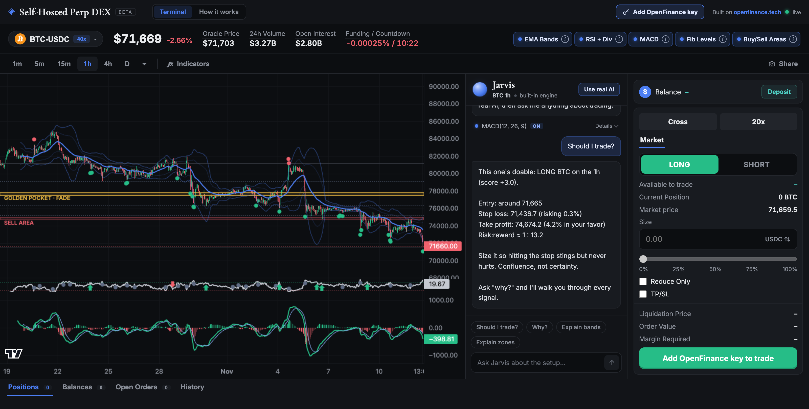
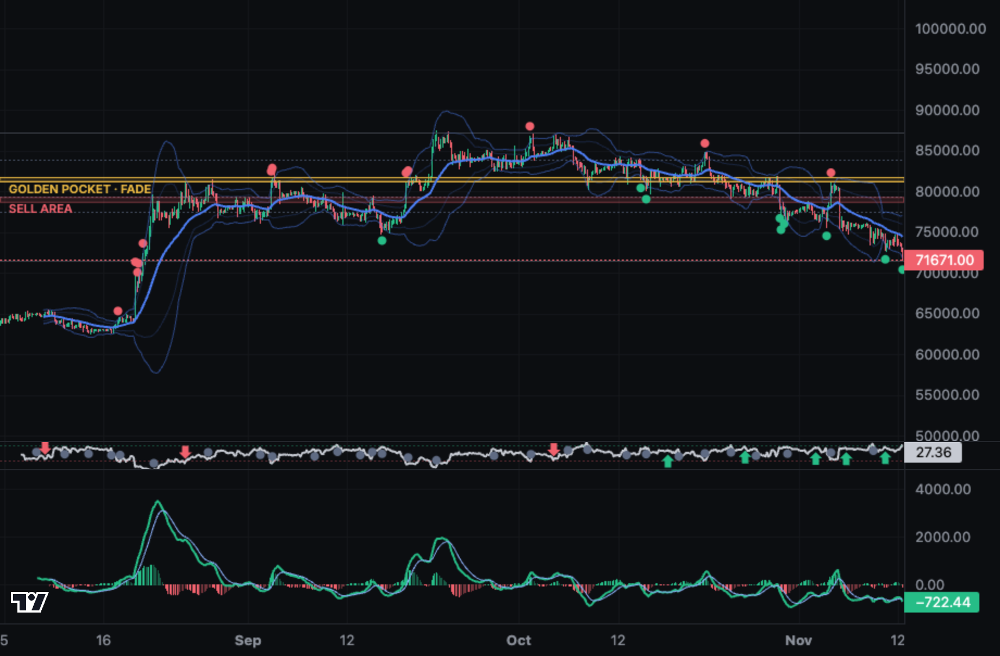
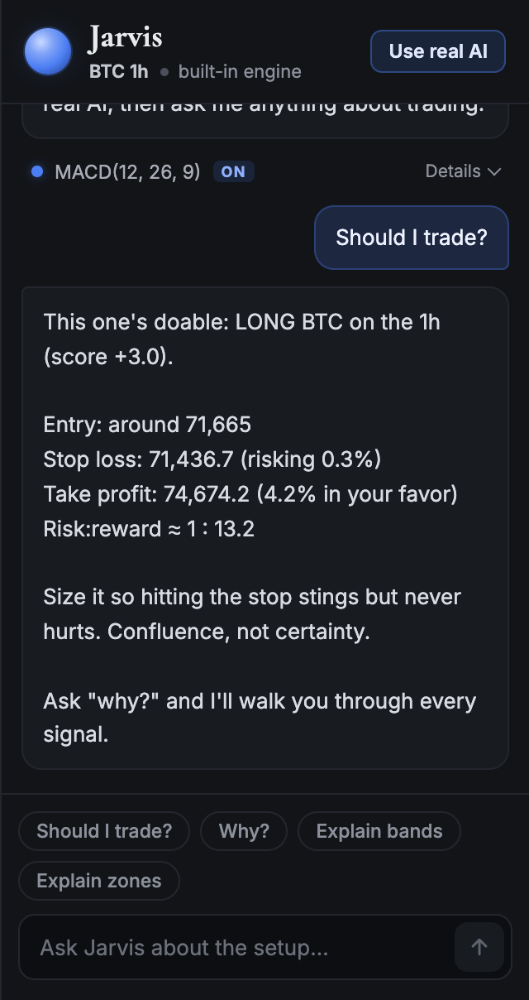
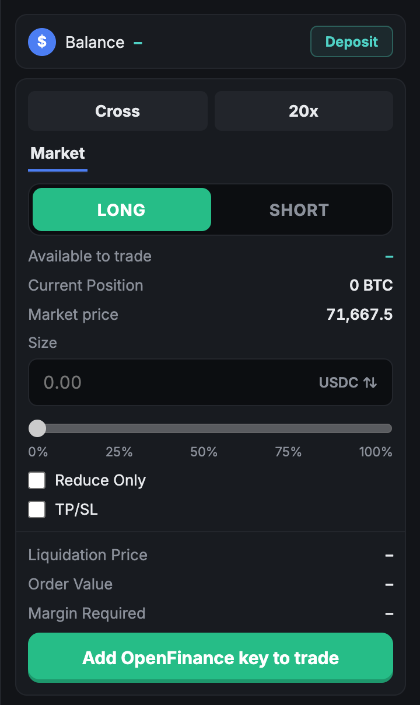
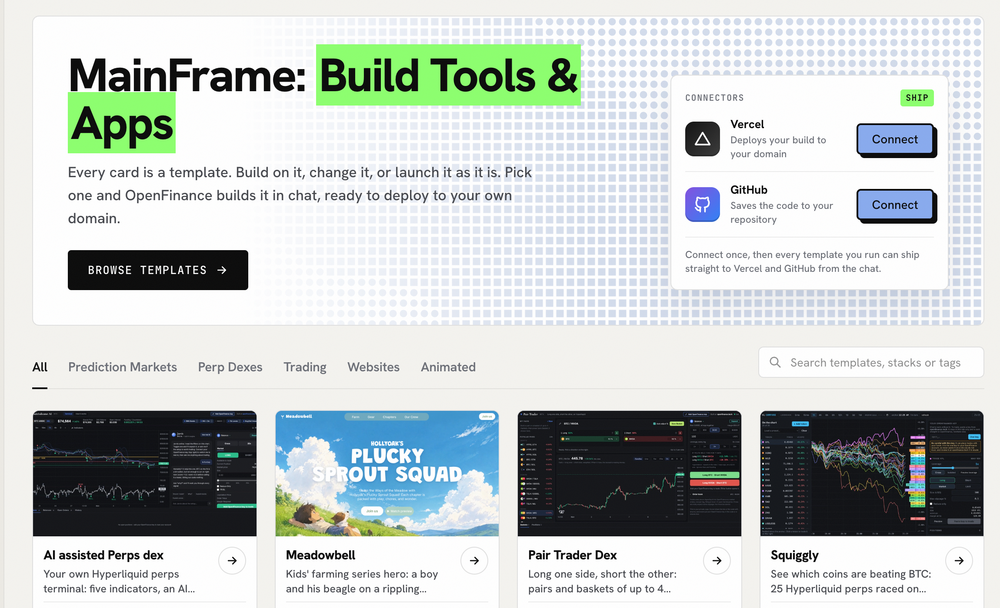
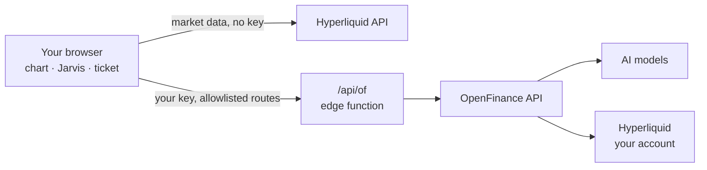

# Self-Hosted Perp DEX with AI Agents

Your own trading terminal for Hyperliquid perpetuals, with an AI agent that reads the chart for you. You host it, you trade from your own account, and one [OpenFinance](https://openfinance.tech) key runs both the trading and the AI.

**▶ [Try the live demo](https://emporia-indicator.vercel.app)**: the chart, indicators and Jarvis, with no key and no sign-up. The demo is analysis only and never places orders.



**[Run it](#run-it) · [Use cases](#use-cases) · [Costs](#what-it-costs) · [Safety](#your-key-and-safety)**

> [!IMPORTANT]
> Orders are real: they go to Hyperliquid from your own account. Jarvis gives advice but never places an order; you confirm every trade yourself.

[](https://x.com/rlclbu)
[](https://x.com/openfinancelabs)

**Guides:** [Setup guide](https://openfinance.tech/agents/self-hosted-perp-dex) · [OpenFinance MCP](https://openfinance.tech/mcp-server) · [TradingView MCP + execution](https://openfinance.tech/agents/tradingview-mcp) · [Docs](https://docs.openfinance.tech)

---

## What you get



- **Chart:** 300+ markets (crypto, US stocks, indices, commodities, FX), every timeframe from 1 minute to 1 month, and 5 indicators you toggle on and off.
- **Jarvis, the AI agent:** ask "Should I trade?" and get a verdict with entry, stop loss, target and the reasons. A free built-in engine, or 8 models from Anthropic, OpenAI, Google, xAI and DeepSeek.
- **Trade ticket:** market orders with leverage, TP/SL, a liquidation estimate and a confirm step.
- **Account:** positions, balances, open orders and recent trades, with close and cancel buttons.

<table>
  <tr>
    <td width="50%"></td>
    <td width="50%"></td>
  </tr>
  <tr>
    <td>Jarvis reads the live chart and gives a scored call.</td>
    <td>The ticket checks the price again before sending.</td>
  </tr>
</table>

---

## Use cases

| You want to... | How it helps |
|---|---|
| Get a second opinion before a trade | Ask Jarvis "Should I trade?" for entry, stop, target and why |
| Trade NVDA, gold or EUR/USD next to BTC | HIP-3 markets sit in the same picker, on the same account |
| Give your community its own terminal | Deploy it on your domain and restyle it by asking in chat |
| Learn what indicators mean | Toggle one and ask Jarvis "why?". Free, no key needed |
| Build on OpenFinance from a browser | A working reference: tab-only key, allowlisted proxy, no withdrawals |

---

## Run it

| | Pick this if | Code | Time | Cost |
|---|---|---|---|---|
| **[Deploy on OpenFinance](#deploy-on-openfinance)** | You don't code and want to change it by chatting | None | A few minutes | Build uses AI credits |
| **[Deploy with Vercel](#deploy-with-vercel)** | You want this exact code live now | None | About 1 minute | Free |
| **[Run on your computer](#run-on-your-computer)** | You want to try it or change the code | Node 20+ | 2 minutes | Free |
| **[Host it yourself](#host-it-yourself)** | You want it always on, on your own machine or server | Node 20+ | 5 minutes | Free |

### Deploy on OpenFinance

<a href="https://openfinance.tech/mainframe"></a>

No code at all. OpenFinance builds the app for you and ships it to your own Vercel and GitHub.

1. Open [openfinance.tech/mainframe](https://openfinance.tech/mainframe) and connect **Vercel** and **GitHub** once.
2. Press **Deploy** on the **AI assisted Perps dex** card.
3. Watch it build in a live preview. When it's done, it ships.

> [!TIP]
> Keep chatting to change it: *"Open on ETH 4h instead of BTC 1h"* or *"Add limit orders to the ticket"*.

<details>
<summary>What Mainframe looks like</summary>



</details>

### Deploy with Vercel

[](https://vercel.com/new/clone?repository-url=https%3A%2F%2Fgithub.com%2Frc-dran%2Fself-hosted-perp-dex&project-name=self-hosted-perp-dex&repository-name=self-hosted-perp-dex)

This repo's exact code, live in about a minute. There are no environment variables to set.

### Run on your computer

Clone the repo:

```bash
git clone https://github.com/rc-dran/self-hosted-perp-dex.git
```

Install and start it:

```bash
cd self-hosted-perp-dex
npm install
npm run dev
```

Then open [http://localhost:3143](http://localhost:3143). You need [Node.js](https://nodejs.org) 20 or newer.

The chart and Jarvis's built-in mode work without a key. Market data comes straight from Hyperliquid, so your network must reach `api.hyperliquid.xyz`.

### Host it yourself

To keep it running on your own computer or a server, build it once and serve it:

```bash
npm start
```

This builds the app and serves it at `http://localhost:3143`, with the same protected `/api/of` route as the Vercel version.

To open it from your phone or another device on the same network:

```bash
npm start -- --host
```

> [!WARNING]
> Your key travels with every request. If you open it to the internet, put it behind HTTPS (for example Caddy or a Cloudflare Tunnel) and keep it to yourself.

Using Netlify, Cloudflare Pages or another host? The front end is a static build that runs anywhere. Port the ~40-line edge function `api/of.ts` to your host's function format, and keep `api/_allow.ts` exactly as it is.

---

## Your key and safety

Open your copy, click **Add OpenFinance key** and paste your key from [openfinance.tech](https://openfinance.tech). Then deposit USDC with the **Deposit** button.

- The key stays in your browser tab only. It is never stored, logged or put in the code.
- The app can trade but cannot withdraw: anything outside a short route list is refused.
- Only paste your key into a copy you deployed yourself.

<details>
<summary>The routes the app is allowed to call</summary>

| Method | Route | Used for |
|---|---|---|
| POST | `agent/v1/chat/completions` | Jarvis with real AI |
| GET | `agent/chat/credits` | AI credit balance |
| GET | `agent/trading/deposit-address` | Your deposit address |
| GET, POST | `agent/trading/abstraction` | One-time account setup |
| POST | `agent/trading/leverage` | Leverage and margin mode |
| POST, DELETE | `agent/trading/orders` | Place and cancel orders |

Everything else gets a 404. See [`api/_allow.ts`](api/_allow.ts).

</details>

---

## What it costs

| Item | Cost |
|---|---|
| Hosting, charts, market data, built-in Jarvis | Free |
| Trading | OpenFinance 2.5 basis points (0.025%) per Hyperliquid trade, plus Hyperliquid's fees |
| Jarvis with real AI | AI credits ($1 = 10 credits), from $ to $$$$ per answer by model |
| Deploy on OpenFinance | The build uses AI credits |

---

## Under the hood

<details>
<summary>The 5 indicators</summary>

| Indicator | What it shows |
|---|---|
| EMA bands | 30 EMA with a 2.5σ envelope; a dot when a candle closes outside it (exhaustion) |
| RSI + divergences | RSI(14) with BULL and BEAR divergence tags between swing pivots |
| MACD | MACD(12, 26, 9) with histogram and crossovers |
| Fibonacci | Auto-anchored to the biggest recent swing; the 0.618 to 0.65 golden pocket in gold |
| Buy / sell zones | Nearest swing pivots above and below the price, sized by ATR |

</details>

<details>
<summary>Jarvis's 8 models</summary>

| Model | Best for | Cost |
|---|---|---|
| Claude Haiku 5.5 (default) | Quick everyday reads | $ |
| GPT-5.6 Luna | Short, to the point | $ |
| DeepSeek V4.1 Flash | Long explanations at the low end of the credit range | $ |
| Gemini 3.8 Flash | Fast with some thinking | $$ |
| Grok 4.7 | Blunt takes | $$ |
| Claude Sonnet 5.5 | Sharper trade plans | $$$ |
| GPT-5.6 Terra | Structured strategy | $$$ |
| Claude Opus 5.5 | Deepest analysis | $$$$ |

</details>

<details>
<summary>How it works</summary>



Market data needs no key and goes straight from your browser to Hyperliquid. Anything with your key goes through `/api/of`, which forwards it to OpenFinance and stores nothing.

</details>

<details>
<summary>Project structure</summary>

```
api/of.ts           Edge function: allowlisted pass-through to OpenFinance
api/_allow.ts       The route allowlist
src/components/     Chart, Jarvis, TradeTicket, BottomPanel, PairSelector, KeyModal
src/lib/            hyperliquid, indicators, zones, jarvis, llm, openfin, ofkey
```

</details>

---

## FAQ

**Does the AI place trades?** No. Jarvis only advises. Orders come from you: the ticket after you confirm, or a position's Close button after two clicks.

**Can this app withdraw my funds?** No. The proxy allows a short route list and withdrawals are not on it. See [`api/_allow.ts`](api/_allow.ts). The key itself can withdraw, so only paste it into a copy you deployed.

**Do I need to code?** No. Use Deploy with Vercel, or Deploy on OpenFinance.

**What does a trade cost?** OpenFinance 2.5 basis points (0.025%) per Hyperliquid trade, plus Hyperliquid's own fees.

**Can I trade options here?** No. Options stay in the OpenFinance app, through your own IBKR or Robinhood account.

---

## Disclaimer

- Leverage can lose you more than you put in.
- Nothing here is investment advice, and the AI can be wrong.
- You are responsible for every order you confirm.
- Check that trading these markets is legal where you live.

---

## Contributing

Fork, branch, commit, and open a pull request. Please keep pull requests small and focused. Security issues: see [SECURITY.md](SECURITY.md).

---

## License

[MIT](LICENSE)
