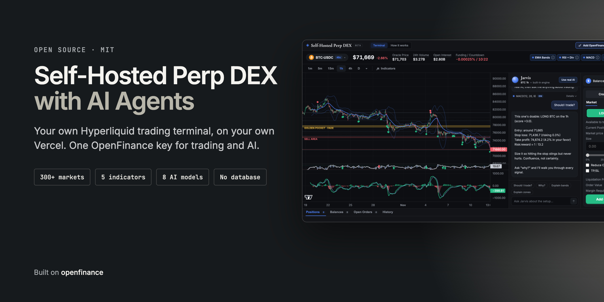
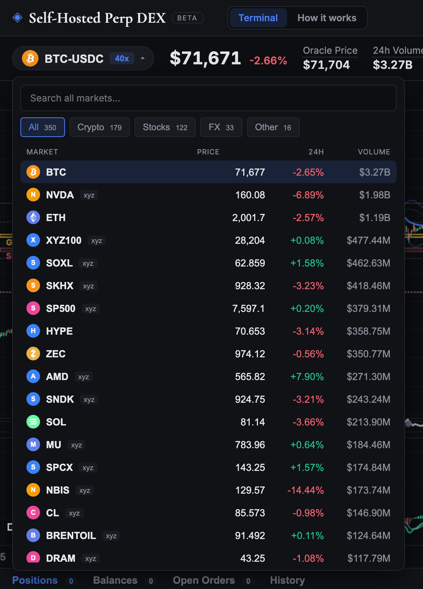
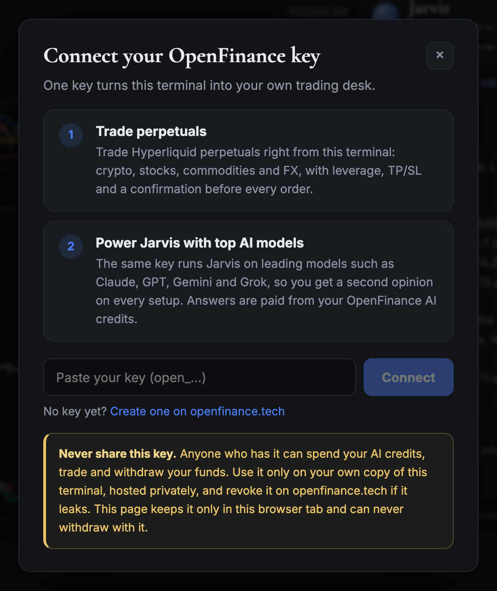
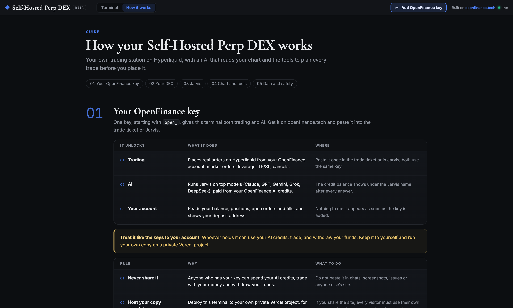
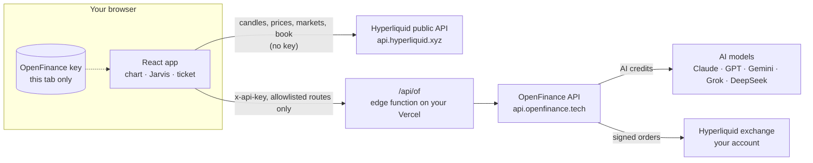
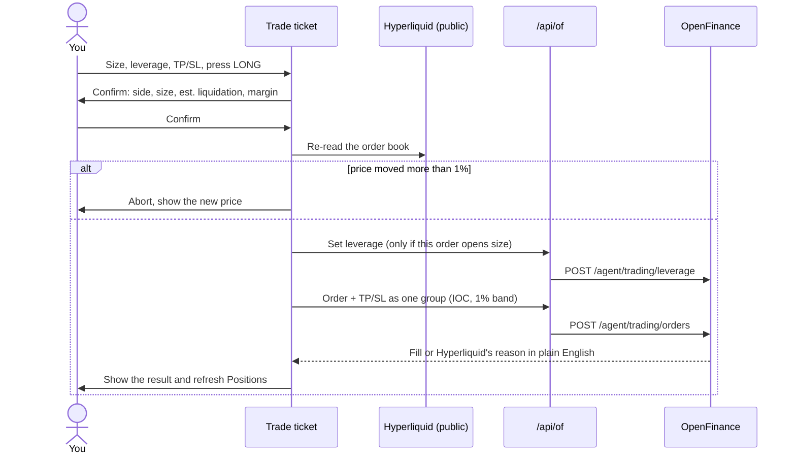

<p align="center">
  
</p>

<p align="center">
  <a href="LICENSE"></a>
  <a href="https://openfinance.tech"></a>
  
  
</p>

# Self-Hosted Perp DEX with AI Agents

**Run your own perpetuals exchange front end, with AI agents that read your chart, and a trade ticket that places real orders.** It's open source and self-hosted: you deploy it to your own Vercel in one click, and it trades more than 300 Hyperliquid markets: crypto, US stocks, indices, commodities and FX. No one else's servers sit between you and your trades except OpenFinance, which signs them.

Most "AI trading" repos stop at analysis: they print a signal and leave the order to you. This one finishes the job. You read the chart, ask the AI whether the setup is worth it, size the trade, confirm it, and watch the position, all on one screen.

Everything runs on **one key**. Your [OpenFinance](https://openfinance.tech) key places the orders *and* runs the AI. There are no exchange API keys, no LLM vendor keys, no database and no server secrets. The app ships with zero environment variables, so a one-click deploy just works.

<p align="center">
  
  <br><sub>The whole terminal on one screen: chart and indicators, Jarvis the AI agent, the trade ticket, and your positions underneath.</sub>
</p>

> [!TIP]
> **Don't code? You don't have to.** Come to [OpenFinance Mainframe](https://openfinance.tech/mainframe), press **Deploy** on the "AI assisted Perps dex" card, and OpenFinance takes care of everything: it builds the app, hosts it on your own Vercel and saves the code to your own GitHub. See [Deploy on OpenFinance](#deploy-on-openfinance-no-code).

---

## Contents

- [Why this exists](#why-this-exists)
- [Features](#features)
- [Who it's for](#who-its-for)
- [How it works](#how-it-works)
- [Deploy on OpenFinance (no code)](#deploy-on-openfinance-no-code)
- [Quick start (local)](#quick-start-local)
- [Deploy your own](#deploy-your-own)
- [Get a key and fund your account](#get-a-key-and-fund-your-account)
- [What it costs](#what-it-costs)
- [Security model](#security-model)
- [Project structure](#project-structure)
- [Make it yours](#make-it-yours)
- [FAQ](#faq)
- [Disclaimer](#disclaimer)
- [License and credits](#license-and-credits)

---

## Why this exists

Hyperliquid is one of the deepest on-chain order books in the world, and through HIP-3 it now lists stocks like NVDA and TSLA, indices, oil and FX next to crypto. But trading it well takes a lot of tools at once: a chart with real indicators, a second opinion before you click, correct liquidation maths, and an order ticket that doesn't fat-finger you.

Self-Hosted Perp DEX puts all of that in a single page that **you own**:

- **Your front end, your rules.** Change the indicators, the layout, the risk limits, the colours or the name. It's MIT-licensed React.
- **An AI that sees what you see.** Jarvis gets the live chart state (trend, RSI, MACD, nearest levels, the scored verdict) with every question, so its answers are about *this* chart right now, not generic market talk.
- **Real execution, not a simulation.** Orders go to Hyperliquid through OpenFinance under your own account. You stay in control: every order is confirmed first.
- **Nothing to run.** No server to maintain, no database, no cron jobs. Market data streams straight from Hyperliquid to the browser; one small edge function forwards your requests to OpenFinance.

---

## Features

### 1. A real charting terminal

<p align="center">
  
</p>

- **TradingView Lightweight Charts** with live candles over the Hyperliquid WebSocket, at every Hyperliquid timeframe from 1 minute to 1 month.
- **Five indicators**, each toggled from the bar above the chart, and each with an (i) button that explains it in plain English:

| Indicator | What it shows | How traders use it |
|---|---|---|
| **EMA Bands** | A 30-period EMA with an envelope 2.5 standard deviations either side, plus a 1.5σ inner ribbon. A dot prints when a candle *closes* beyond the outer band. | Ride the trend between the mid line and the band; treat a dot as exhaustion, never as a reason to chase. |
| **RSI + divergences** | RSI(14), swing pivots, and automatic BULL / BEAR divergence tags between consecutive pivots. | A divergence landing on the same bars as a band dot is the strongest signal on the screen. |
| **MACD** | MACD(12, 26, 9) with histogram, in its own pane. | Momentum and crossovers; Jarvis reports how many bars ago the last cross happened. |
| **Fib levels** | 0.382 / 0.5 / 0.618 / 0.65 / 0.786, auto-anchored to the biggest swing of the last ~250 bars. The 0.618 to 0.65 "golden pocket" is drawn in gold. | Pullback entries in an uptrend, fade zones on a bounce in a downtrend. |
| **Buy / Sell areas** | Supply and demand zones from the nearest untested swing pivots, sized by ATR so they scale with volatility. | Where stops and limit orders cluster; natural places for entries, stops and targets. |

- **Market header** with mark price, 24h change, oracle price, 24h volume, open interest, and funding with a countdown to the next payment.
- **Share** button that exports the chart as an image.
- Prices of any size display correctly, from BTC down to sub-cent tokens like kPEPE.

### 2. AI agents: Jarvis on 8 models

<p align="center">
  
</p>

Jarvis is the AI agent that lives next to the chart. It reads the market and advises; you stay in charge and confirm every order. It works in two modes:

**Built-in engine (free, no key).** A local rules engine that reads every indicator, scores the confluence, and gives a plain-English verdict. It only calls a trade when the score passes ±2.5; otherwise it tells you to sit out, which costs nothing. Ask "why?" and it lists every signal and how much it counted. Toggle an indicator and Jarvis explains what it does and what it reads on this chart right now.

**Real AI (with your key).** Connect your OpenFinance key and Jarvis becomes a full trading assistant on top models. Every question carries the live chart context and the built-in verdict, so the model reasons about real numbers instead of guessing. Answers stream in as they're written, the last 8 turns are kept as memory, and your AI credit balance appears under the name after each answer. Pick the model from the menu:

| Model | Best for | Speed | Cost |
|---|---|---|---|
| Claude Haiku 5.5 (default) | Quick reads and everyday questions | ~6 s | $ |
| GPT-5.6 Luna | Fast, short, to the point | ~5 s | $ |
| DeepSeek V4.1 Flash | Cheapest; long explanations | ~6 s | $ |
| Gemini 3.8 Flash | Fast with a bit of thinking | ~7 s | $$ |
| Grok 4.7 | Blunt takes and market chatter | ~12 s | $$ |
| Claude Sonnet 5.5 | Sharper trade plans, more scenarios | ~8 s | $$$ |
| GPT-5.6 Terra | Structured plans and strategy | ~6 s | $$$ |
| Claude Opus 5.5 | Deepest analysis; big decisions | ~15 s | $$$$ |

Jarvis is honest by design: the live chart is its only live data, so it won't invent prices or news, and it can't see your account. When something fails (out of credits, key rejected, connection dropped) it says so in a plain sentence instead of showing an error code.

### 3. A trade ticket that places real orders

<p align="center">
  
</p>

- **Long or short** any market at market price, with **Cross or Isolated** margin and a leverage picker up to each market's maximum.
- **Size in USDC or in coins**, or drag the slider to a percentage of what you can afford. The slider already accounts for the 1% slippage band and fees, so 100% really fits.
- **Take profit and stop loss** attached to the same order, checked against the rounded prices Hyperliquid will actually use.
- **Reduce only**, and close-only orders become reduce-only automatically, so small closes under Hyperliquid's $10 minimum still work.
- **Live estimates** of liquidation price, order value and margin. The liquidation maths follows Hyperliquid's own formula, including other positions on the same account.
- **A confirmation step before every order.** At send time the ticket re-reads the order book and aborts if the price has moved more than 1%.
- **Deposit** shows your account's Hyperliquid deposit address. There is no withdraw button, on purpose (see [Security model](#security-model)).

### 4. 300+ markets in one picker

<p align="center">
  
</p>

Every native Hyperliquid perp plus every HIP-3 market (stocks such as NVDA, AMD and MU, indices like the S&P 500, oil, metals and FX), searchable and sorted by 24h volume, with price, 24h change and volume on each row.

### 5. Your account at a glance

The panel under the chart shows **Positions** (with live PnL and a two-click Close), **Balances**, **Open orders** (with Cancel) and **History** (your fills). The top bar shows your unrealised PnL. Balances follow Hyperliquid's unified account, so spot and perp USDC are one number, never double-counted.

### 6. A one-key connect flow

<p align="center">
  
</p>

One button in the top bar connects your key for both the ticket and Jarvis. The modal explains what the key unlocks and how to keep it safe, and links to openfinance.tech for anyone who doesn't have one yet.

### 7. A built-in guide

<p align="center">
  
</p>

The **How it works** tab is a full in-app manual: what the key unlocks, how the ticket works, which model to pick, what every indicator means and where every piece of data comes from. The terminal keeps running in the background while you read.

---

## Who it's for

**Traders** get a focused Hyperliquid terminal with indicators that explain themselves, an AI second opinion on every setup, and a ticket with liquidation maths you can trust. Crypto, stocks and commodities all sit in one place, on one account.

**Builders and quants** get a working, production-shaped reference for trading on Hyperliquid through OpenFinance: market data over WebSocket, the asset-index rules for HIP-3 markets, price and size rounding, unified-account balances, liquidation maths, TP/SL grouping, streaming LLM calls, and a safe key pass-through. Fork it and start from a page that already places orders.

**Communities, creators and funds** can run a branded terminal for their audience: your logo, your default markets, your indicators. Each visitor trades on their own account with their own key.

---

## How it works



There are two data paths:

1. **Market data needs no key.** The browser talks straight to Hyperliquid's public API and WebSocket for candles, live prices, the market list and order books. Nothing goes through your server.
2. **Anything with your key goes through `/api/of`.** OpenFinance doesn't accept calls directly from browsers on other domains, so the app ships one tiny edge function (`api/of.ts`). It forwards the key from the request header to `api.openfinance.tech`, streams the answer back, stores nothing and logs nothing. It only passes the routes on a short allowlist; everything else gets a 404.

**What happens when you place an order:**



---

## Deploy on OpenFinance (no code)

**Just come to OpenFinance, press Deploy, and we take care of everything.** No terminal, no Node.js, no Git, no config. If you can use a chat, you can run your own perp DEX.

<p align="center">
  
  <br><sub>OpenFinance Mainframe: connect Vercel and GitHub once, then deploy any template. This app is the first card, "AI assisted Perps dex".</sub>
</p>

### Step by step

1. **Sign in at [openfinance.tech](https://openfinance.tech).** New here? Create an account; your OpenFinance key comes with it.
2. **Open [Mainframe](https://openfinance.tech/mainframe).** It's under **Agent** in the sidebar.
3. **Connect Vercel and GitHub, once.** Use the two **Connect** buttons in the Connectors card. Vercel is where your app will live, on a URL that's yours alone. GitHub is where your code is saved, so nothing is lost and every change is tracked. You only do this the first time; every template after that ships straight away.
4. **Press Deploy on "AI assisted Perps dex".** It's the first card under **All**, and it's also in the **Perp Dexes** tab. You can open the card first to see a full-size preview and read the exact prompt it runs.
5. **Watch it build.** OpenFinance opens a chat in **Build** mode and the AI agent writes the whole app from the template's full spec: chart, indicators, Jarvis, the trade ticket and the safe key pass-through. You see it take shape in a live preview as it goes.
6. **It ships.** When the build is done, it goes straight to your Vercel and your GitHub. You get your own link.
7. **Open your link, connect your key, trade.** Same as any other copy: press **Add OpenFinance key**, deposit USDC, and you're live.

### What we take care of

| You'd normally have to... | On OpenFinance |
|---|---|
| Install Node.js, clone the repo, install packages | Nothing to install. The build runs on OpenFinance. |
| Set up hosting and deploy | Deployed to your own Vercel for you. |
| Create a repository and push the code | Saved to your own GitHub for you. |
| Read the code to change anything | Describe the change in plain English. |
| Wire up the OpenFinance API and keep the key safe | Built in: the template includes the allowlisted pass-through and the tab-only key store. |

### Make changes by asking

Your build stays in the chat, so you can keep talking to it. For example:

- "Make the accent colour green and call it *Alpha Desk*."
- "Open on ETH 4h instead of BTC 1h."
- "Add limit orders to the ticket."
- "Add an alert when price touches the golden pocket."

The AI makes the change, and you can ship the new version to the same Vercel project and GitHub repository.

### Which way should I deploy?

| | **Deploy on OpenFinance** | **Deploy with Vercel** | **Run locally** |
|---|---|---|---|
| Coding needed | None | None to deploy; code to change it | Yes |
| What you do | Press Deploy, then chat | Press the button, then edit code | Clone, install, run |
| How you change it | Describe it in plain English | Edit the code | Edit the code |
| Where it lives | Your Vercel + your GitHub | Your Vercel + your GitHub | Your computer |
| Cost | The build uses your OpenFinance AI credits | Free | Free |
| Best for | Traders, creators, communities | Developers who want this exact code | Developers |

> [!NOTE]
> On OpenFinance the AI rebuilds the app from the template's spec as a Next.js app, so your copy has the same features and safety rules as this repo, written fresh for you. Use **Deploy with Vercel** if you want this repo's exact code.

---

## Quick start (local)

You need **Node.js 20+**.

```bash
git clone https://github.com/rc-dran/self-hosted-perp-dex.git
```

```bash
cd self-hosted-perp-dex && npm install
```

```bash
npm run dev
```

Open the address Vite prints. The chart, the market list and Jarvis's built-in engine all work straight away without a key. Click **Add OpenFinance key** to turn on trading and real AI.

In development, Vite's proxy plays the part of `/api/of`, with the same allowlist, so local behaves exactly like production.

To make a production build in `dist/` (and type-check first):

```bash
npx tsc --noEmit && npm run build
```

---

## Deploy your own

Not a developer? Skip this and [deploy on OpenFinance](#deploy-on-openfinance-no-code) instead: no code, no setup.

### Option 1: one click with Vercel (recommended for developers)

[](https://vercel.com/new/clone?repository-url=https%3A%2F%2Fgithub.com%2Frc-dran%2Fself-hosted-perp-dex&project-name=self-hosted-perp-dex&repository-name=self-hosted-perp-dex)

1. Click the button and sign in to Vercel (the free Hobby plan is enough).
2. Vercel copies this repo into your GitHub account and builds it. There are **no environment variables** to fill in.
3. About a minute later you get your own URL, such as `self-hosted-perp-dex-yourname.vercel.app`.
4. Open it, click **Add OpenFinance key**, and you're trading.

Every push to your copy redeploys it automatically.

### Option 2: Vercel CLI

```bash
npm i -g vercel
```

```bash
vercel deploy --prod
```

Vercel detects Vite from `vercel.json`, builds to `dist/`, and serves `api/of.ts` as an edge function.

### Option 3: other hosts

The front end is a static Vite build that runs anywhere. The only server piece is `/api/of`, a ~40-line edge function. On Netlify, Cloudflare Pages or your own server, port `api/of.ts` to that platform's function format (it uses only `fetch`, `Request` and `Response`) and keep the allowlist in `api/_allow.ts` exactly as it is.

### Custom domain and staying up to date

- Add a domain under **Project → Settings → Domains** in Vercel.
- To pull in new versions, use **Sync fork** on GitHub (or `git pull` from this repo), and Vercel redeploys.

> [!IMPORTANT]
> **Deploy your own copy and use your key only there.** Whoever deploys a copy controls its code. If you share your URL, every visitor must connect their *own* key, and they're trusting you not to have changed the code. Never paste your key into a copy someone else runs.

---

## Get a key and fund your account

1. Create an account at **[openfinance.tech](https://openfinance.tech)** and copy your API key (it starts with `open_`). One key per account covers trading and AI.
2. Open your deployed terminal, click **Add OpenFinance key**, paste it, and press **Connect**.
3. Press **Deposit** on the ticket to see your account's Hyperliquid deposit address. Hyperliquid accepts **USDC only**.
4. To use real AI in Jarvis, top up AI credits on openfinance.tech. The built-in engine stays free.

---

## What it costs

| Item | Cost |
|---|---|
| Running the terminal | Free: Vercel Hobby covers it, and there's no database or server to pay for. |
| Deploying on OpenFinance | The build is paid from your OpenFinance AI credits, like any chat. Deploy with Vercel and local runs are free. |
| Charts, market data, Jarvis built-in engine | Free. |
| Trading | OpenFinance charges 2.5 basis points (0.025%) on Hyperliquid trades. Hyperliquid's own trading fees apply on top. |
| Jarvis real AI | Paid from your OpenFinance AI credits ($1 = 10 credits). The `$` to `$$$$` marks in the model picker show relative cost per answer. |

---

## Security model

Your OpenFinance key can trade and move funds, so the app is built around protecting it:

- **Never stored.** The key lives only in the open browser tab (`sessionStorage`) and is gone when you close the tab. It is never written to `localStorage`, a cookie, the URL, logs or the build.
- **Sent only to your own copy.** The browser sends the key in the `x-api-key` header to the same-origin `/api/of`, which forwards it to `api.openfinance.tech` and nowhere else.
- **No withdrawals through this app.** The pass-through only allows these routes. Withdrawals, transfers and wallet routes return 404, so even modified front-end code running on an unmodified `/api/of` can't move funds out.

| Method | Route | Used for |
|---|---|---|
| POST | `agent/v1/chat/completions` | Jarvis real AI |
| GET | `agent/chat/credits` | AI credit balance; also proves the key works |
| GET | `agent/trading/deposit-address` | Your Hyperliquid address |
| GET, POST | `agent/trading/abstraction` | One-time unified-account setup |
| POST | `agent/trading/leverage` | Set leverage and margin mode |
| POST, DELETE | `agent/trading/orders` | Place and cancel orders |

- **Not an open proxy.** No key, no request; unknown routes are refused; only the key and content type headers are forwarded.
- **Text from APIs is never rendered as HTML.** AI answers and error messages are shown as plain text, so a hostile response can't inject script.
- **No secrets in the repo or the bundle.** There is nothing to leak: the app has no server-side keys at all.

If your key ever leaks, revoke it on openfinance.tech and create a new one. To report a vulnerability, see [SECURITY.md](SECURITY.md).

---

## Project structure

```
self-hosted-perp-dex/
├── api/
│   ├── of.ts              # Edge function: allowlisted pass-through to OpenFinance
│   └── _allow.ts          # The route allowlist (shared with the dev proxy)
├── src/
│   ├── App.tsx            # Layout and shared state
│   ├── components/
│   │   ├── Header.tsx         # Brand, Terminal / How it works tabs, key button, uPnL
│   │   ├── PairSelector.tsx   # 300+ market picker with categories and search
│   │   ├── Chart.tsx          # Lightweight Charts, panes, indicator overlays, share
│   │   ├── Jarvis.tsx         # Copilot chat, model picker, streaming answers
│   │   ├── RiskPanel.tsx      # Right column: ticket + key levels
│   │   ├── TradeTicket.tsx    # Order entry, sizing, TP/SL, confirm, send
│   │   ├── BottomPanel.tsx    # Positions, balances, open orders, history
│   │   ├── KeyModal.tsx       # Connect / forget key
│   │   └── HowItWorks.tsx     # In-app guide
│   └── lib/
│       ├── hyperliquid.ts     # Public REST + WebSocket client, candles, book
│       ├── universe.ts        # Native + HIP-3 market list and asset indexes
│       ├── indicators.ts      # EMA bands, RSI + divergences, MACD, fibs
│       ├── zones.ts           # Buy / sell areas (pivots + ATR)
│       ├── jarvis.ts          # Built-in engine, explainers, AI context
│       ├── llm.ts             # Model list, streaming chat, error handling
│       ├── openfin.ts         # Account state, order maths, send sequence
│       ├── ofapi.ts           # Calls to /api/of with the visitor's key
│       └── ofkey.ts           # The tab-only key store
├── vercel.json            # Vite build + SPA rewrite (keeps /api/ untouched)
└── vite.config.ts         # Dev server + the same allowlisted proxy
```

---

## Make it yours

Some ideas that fit the codebase well:

- **Limit orders and a working order book.** The ticket is market-only on purpose; Hyperliquid limit orders are a small addition in `openfin.ts`.
- **Your own indicator.** Add a function to `lib/indicators.ts`, a toggle in the bar, and an entry in `EXPLAINERS` so Jarvis can explain it.
- **Give Jarvis tools.** Let the AI read your positions or draft an order for you to confirm.
- **Alerts.** Browser notifications when price reaches a fib level or a zone.
- **Rebrand.** Change the name in `Header.tsx` and `index.html`, the colours in `styles.css`, and the default market in `App.tsx`.

Prefer to build by describing? This app is also a template on **[OpenFinance Mainframe](https://openfinance.tech/mainframe)**: open it, say what to change, and the AI builds your version.

---

## FAQ

**Do I need a key to try it?**
No. The chart, all 300+ markets, every indicator and Jarvis's built-in engine work without one. You need a key to trade and to use the AI models.

**Can I get my own copy without coding?**
Yes. Go to [openfinance.tech/mainframe](https://openfinance.tech/mainframe), connect Vercel and GitHub, and press **Deploy** on "AI assisted Perps dex". OpenFinance builds it and ships it to your accounts. See [Deploy on OpenFinance](#deploy-on-openfinance-no-code).

**Is this a DEX or a front end?**
It's your own front end on Hyperliquid's on-chain order book. Orders are placed through OpenFinance under your own OpenFinance account.

**Can I offer it to my community?**
Yes. Deploy your copy and share the link; each visitor connects their own key and trades on their own account. Tell them to read the code (or the [Security model](#security-model)) first.

**The chart says "Loading candles…" forever.**
Market data comes straight from `api.hyperliquid.xyz` in your browser. If your network or region blocks Hyperliquid, the chart can't load. Check that you can reach Hyperliquid from that network.

**Which order types are supported?**
Market orders (IOC within a 1% band), TP/SL attached to the order, reduce-only, leverage and margin mode, cancel and close.

---

## Disclaimer

This software is provided for educational and informational purposes. It is **not financial advice**. Trading perpetual futures with leverage carries a high risk of loss, including losing more than your margin through liquidation. Jarvis's verdicts and AI answers can be wrong. You are responsible for every order you confirm. Past performance of any signal or indicator does not predict future results. Check that trading these markets is legal where you live.

---

## License and credits

[MIT](LICENSE). Use it, fork it, sell it, rebrand it.

- Charts by [TradingView Lightweight Charts™](https://www.tradingview.com/lightweight-charts/) (the TradingView mark on the chart is part of its license).
- Market data from the [Hyperliquid](https://hyperliquid.xyz) public API.
- Trading and AI through [OpenFinance](https://openfinance.tech): one API for Hyperliquid, Polymarket, on-chain swaps and more. Docs at [docs.openfinance.tech](https://docs.openfinance.tech).
